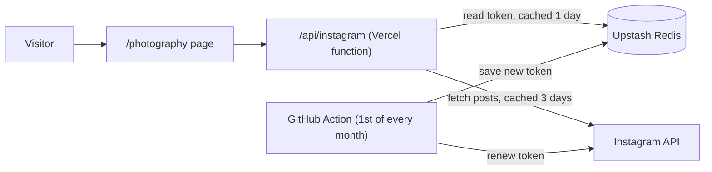

# Ashish Kumar Panda - Coder | Artist | Traveller

Adjusting focal lengths globally, tuning AI hyperparameters locally. A seasoned developer and MSCS student with a photographer's eye.


## Tech stack

| Layer | Technology |
|---|---|
| Framework | Next.js 15 (App Router) with React 19 and TypeScript |
| Styling | Tailwind CSS with shadcn/ui components (Radix UI primitives) |
| Animation | Framer Motion, Lenis smooth scrolling, three.js and hand-written WebGL shaders |
| Sound | Synthesized in the browser with the Web Audio API (no audio files) |
| State | Zustand |
| Icons | Lucide |
| Hosting | Vercel |
| Photo feed | Instagram API with Instagram Login (Meta) |
| Token store | Upstash Redis (REST API) |
| Scheduled jobs | GitHub Actions |

## Pages

The site is built around CAT: Coder, Artist, Traveller. The home page is a route of six levels, and each letter has a page of its own.

| Route | What it shows |
|---|---|
| `/` | The player (a portrait you can spin, with a scribble lens), about, experience, projects, and the three paths |
| `/courses` | Coder: coursework and competition wins as a code editor with a terminal you can type into |
| `/photography` | Artist: a scroll-driven walk through the newest photos hanging in depth, each with its caption card; a button opens the whole feed hung by year like a museum; then the arts record |
| `/travels` | Traveller: every photo with a tagged location, grouped by area, labelled with the spot and month, on a contour map, with the adventure and community work |

`/extracurriculars` no longer exists; it redirects to the three paths on the home page, and its three categories now live on the page of the letter they belong to.

Instagram does not share a post's tagged location with websites, so the locations were read from the public post pages and recorded in [`src/lib/places.ts`](src/lib/places.ts); the file explains how to add one.

Most site content (experience, projects, publications, courses, extracurriculars) lives in [`src/lib/config.ts`](src/lib/config.ts). The levels, the three classes and the achievements are in [`src/lib/journey.ts`](src/lib/journey.ts).

## How the interactive parts work

- **Shell.** [`src/components/shell/`](src/components/shell/) is mounted once in the root layout, so the cursor, the HUD, smooth scrolling and the music carry across page changes. The start gate asks whether to enter with sound, which is also the click browsers require before audio may play.
- **Sound.** [`src/lib/audio/engine.ts`](src/lib/audio/engine.ts) synthesizes every effect and the ambient music. Links and buttons get hover and click sounds from one delegated listener in [`use-global-sfx.ts`](src/hooks/use-global-sfx.ts); add `data-sfx="none"` to opt an element out.
- **The figure.** [`player-figure.tsx`](src/components/hero/player-figure.tsx) plays a short turntable spin and can be dragged round by hand. The cursor carries a lens that redraws the portrait as an orange scribble on black.
- **Page backgrounds.** Each class page has a living background that answers the cursor: falling code for Coder and slow-moving paint for Artist ([`page-fields.tsx`](src/components/game/page-fields.tsx)), and the contour map for Traveller and the home page ([`topo-field.tsx`](src/components/game/topo-field.tsx)).
- **Smoke cursor.** [`src/lib/fluid.ts`](src/lib/fluid.ts) is a small GPU fluid simulation: the pointer injects smoke and force, more of both the faster it moves, and the screen edges are walls. It is tinted with the page's accent and steered by the background, so over the contour map it flows along the contour lines.
- **Avatars.** [`cloaked-avatar.tsx`](src/components/hero/cloaked-avatar.tsx) stands the figure in front of each class's world, drawn in a shader: falling code and a neural net for Coder, flowing colour for Artist, wind-blown mountains for Traveller. The face is never altered.
- **Gallery walk.** [`flow.tsx`](src/components/gallery/flow.tsx) uses three.js: the photos hang one behind another in a dark space and scrolling walks the camera forward through them. The view leans with the pointer, and a print under it ripples, turns and can be opened. [`museum.tsx`](src/components/gallery/museum.tsx) is the framed hang shown when the visitor asks for the whole gallery.
- **Sketch details.** [`sketch-image.tsx`](src/components/game/sketch-image.tsx) gives any image the same scribble lens using an SVG filter; [`doodles.tsx`](src/components/game/doodles.tsx) holds the hand-drawn strokes and margin notes.
- **Experience scenes.** [`vignettes.tsx`](src/components/experience/vignettes.tsx) has one small interactive scene per role; any number shown is read from that role's text in `config.ts`. [`odia-field.tsx`](src/components/experience/odia-field.tsx) floats Odia numerals around the publication.
- **Screen sizes.** Layouts are sized in rem and the root size grows on monitors wider than 1536px, so the whole design scales up. Short landscape screens get their own arrangements where needed.
- **Reduced motion and no WebGL.** With reduced motion set, the spin, the wobble and the smooth scrolling are off and the backgrounds are still. Without WebGL the figure falls back to a plain image.

### Rebuilding the figure's images

The figure's frames in `public/hero/` are generated from the source clip in `assets/hero-src/` and the cutout masks in `assets/hero-masks/`:

```bash
node scripts/build-hero-frames.mjs
```

The masks only need regenerating if the source clip changes; [`scripts/make-hero-masks.py`](scripts/make-hero-masks.py) explains how.

## How the photography gallery works



- **No login for visitors.** The server fetches posts with the site owner's access token; visitors only receive image links.
- **Caching.** Posts are refetched at most every 3 days, because Instagram's image links expire after about 5 days. New uploads appear within 3 days.
- **What's shown.** Photos and multi-photo posts (cover image only). Videos and reels are skipped, and the 6 oldest posts are hidden.
- **Token renewal.** Instagram tokens last 60 days. [`refresh-instagram-token.yml`](.github/workflows/refresh-instagram-token.yml) renews the token monthly and saves it to Redis, where the site reads it. If Redis isn't configured, the site falls back to the `INSTAGRAM_ACCESS_TOKEN` environment variable.

## Configuration

Set these in Vercel (Settings → Environment Variables) and as GitHub Actions secrets. For local development, put them in `.env`, which is not committed.

| Variable | Purpose |
|---|---|
| `INSTAGRAM_ACCESS_TOKEN` | Initial long-lived Instagram token (from the Meta app's Instagram API setup) |
| `UPSTASH_REDIS_REST_URL` | Upstash Redis REST endpoint |
| `UPSTASH_REDIS_REST_TOKEN` | Upstash Redis REST token |

## Running locally

```bash
npm install
npm run dev   # http://localhost:9002
```
